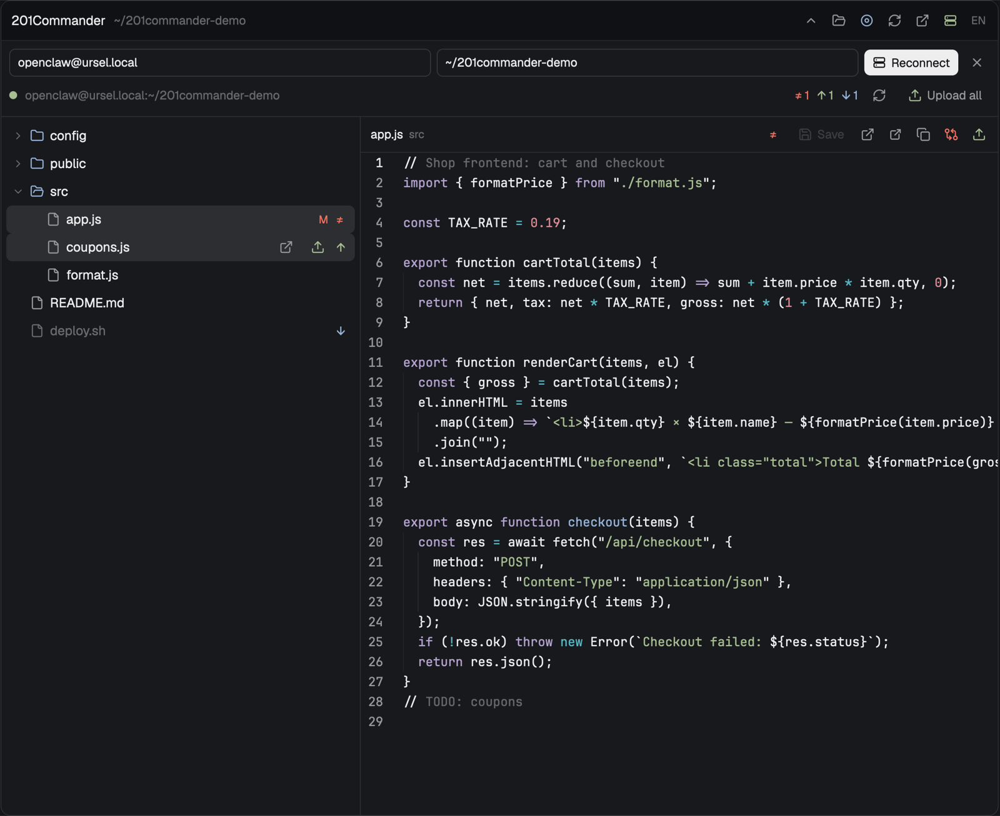
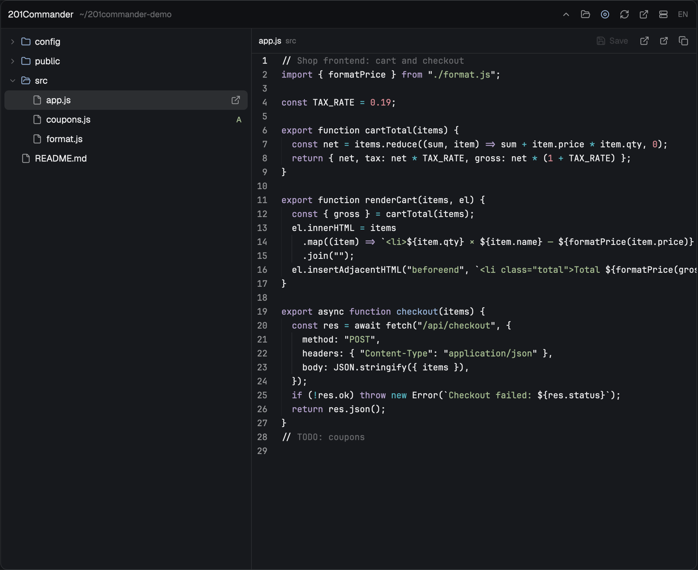
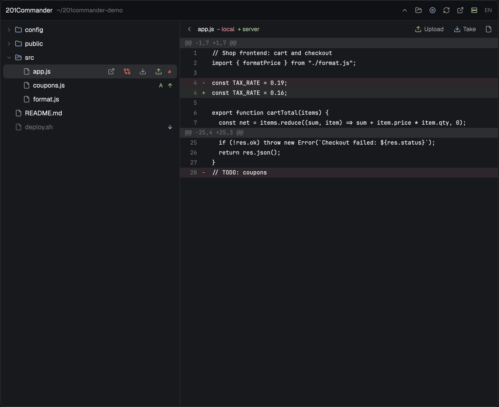
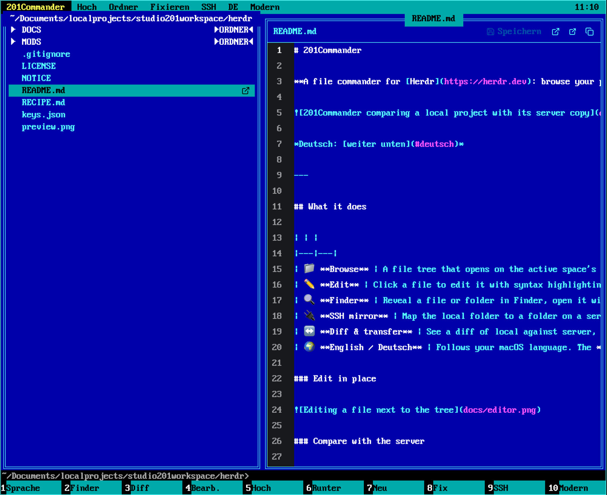
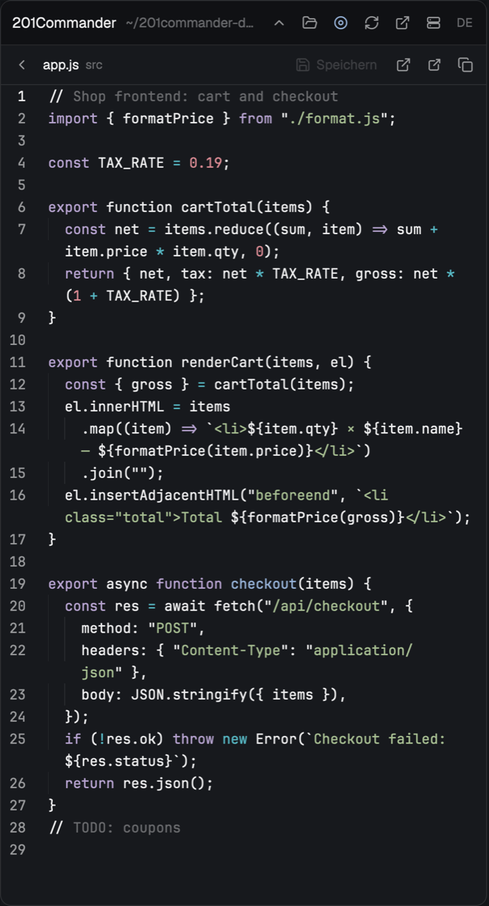

# 201Commander

**A file commander for [Herdr](https://herdr.dev): browse your project, edit files in place, jump to Finder, and keep a server folder in sync over SSH (compare, diff, upload, download) without leaving your terminals.**



*Deutsch: [weiter unten](#deutsch)*

---

## What it does

| | |
|---|---|
| 📁 **Browse** | A file tree that opens on the active space's main folder, the repository Herdr names the space after. Git status marks (A/M/D/U) are shown next to files. |
| ✏️ **Edit** | Click a file to edit it with syntax highlighting. **⌘S** saves. If the file changed on disk in the meantime, you choose between reload and overwrite. |
| 🔍 **Finder** | Reveal a file or folder in Finder, open it with its default app, copy its path, or open a terminal there. |
| 🔌 **SSH mirror** | Map the local folder to a folder on a server with the same structure. 201Commander compares both sides (md5) and marks every file: `≠` differs, `↑` local only, `↓` only on the server. |
| ↔️ **Diff & transfer** | See a diff of local against server, upload a file or folder, take the server version, or upload all differences at once. It asks before anything gets overwritten. |
| 🌍 **English / Deutsch** | Follows your macOS language. The **EN/DE** button in the header switches it. |
| 💾 **Retro mode** | One click turns it into a blue DOS-style file commander: double-line panels, a cyan selection bar, the IBM VGA pixel font, a command line and a working F1–F10 key bar. |

### Edit in place



### Compare with the server

Open the SSH bar (server icon), enter `user@host` and the remote folder, and click **Connect**. The mapping is saved per local folder, and subfolders inherit it. Next time it reconnects by itself.



### Retro mode

Click the monitor icon in the header (or press **F10** in retro mode to go back). The look is shared by every open 201Commander.



| Key | Action | Key | Action |
|---|---|---|---|
| F1 | Language EN/DE | F6 | Get the server version |
| F2 | Show in Finder | F7 | Reload and compare again |
| F3 | Diff with the server | F8 | Pin / back to the main folder |
| F4 | Edit the selected file | F9 | SSH bar |
| F5 | Upload | F10 | Back to the modern look |

The F-keys work while 201Commander has the focus if you merged `keys.json`. Without it, click them in the key bar.

### Narrow side panel

In a narrow panel the tree and the editor take turns, and long lines wrap.



---

## Install

### Requirements

- Herdr 0.1.16 or newer (the desktop app with mods).
- macOS. Finder, “open with default app” and “copy path” use `open` and `pbcopy`. Browsing, editing and SSH work everywhere Herdr runs.
- For the SSH mirror: `ssh`, `tar` and `diff` locally, `sh`, `tar` and `md5sum` (or `md5`) on the server, and **key or agent login**. There is no password prompt.

### Option A: let an agent in Herdr do it

Ask any agent running in Herdr:

> Add the Herdr mod from https://github.com/tkrahmer/201commander

The agent follows Herdr's own instructions for adding mods: it copies the mod, merges the keys and checks the result.

### Option B: by hand

```sh
git clone https://github.com/tkrahmer/201commander.git
cp -R 201commander/mods/201commander ~/.config/herdr-app/mods/
herdr-app check ~/.config/herdr-app/mods/201commander
```

Herdr picks the mod up within a second, no restart needed.

**Shortcuts (optional):** merge the bundled [`keys.json`](keys.json) into `~/.config/herdr-app/keys.json`:

```json
{
  "global": { "cmd-shift-e": { "command": "pane.split", "args": { "direction": "right", "mod": "201commander" } } },
  "mod:201commander": {
    "cmd-s": "201commander.save",
    "f1": "201commander.f1", "f2": "201commander.f2", "f3": "201commander.f3", "f4": "201commander.f4", "f5": "201commander.f5",
    "f6": "201commander.f6", "f7": "201commander.f7", "f8": "201commander.f8", "f9": "201commander.f9", "f10": "201commander.f10"
  }
}
```

### Open it

| How | Command |
|---|---|
| As a pane next to your terminal | **⌘⇧E**, or `herdr-app do pane.split --direction right --mod 201commander` |
| As a tab of its own | `herdr-app do tab.new --mod 201commander` |
| As a floating window | `herdr-app do mod.open --name 201commander` |

**As a button in the tab bar (like Files / Changes):** Herdr's own layout and tab bar are read-only, so clone them first:

```sh
herdr-app do mod.clone '{"name":"tabs","as":"my-tabs"}'
herdr-app do layout.clone '{"name":"main","as":"my-main"}'
```

Then, in `layouts/my-main.json`, point the `tabs` block to `my-tabs` and add `{ "id": "201commander", "type": "block", "content": { "mod": "201commander" } }` to the `panel-body` stack. In `mods/my-tabs/main.js`, add `"201commander"` to the `enabled` list and a `panelButton("201commander", "201Commander", "mods/201commander/icons/folder-open.svg")` next to the Files button. Or ask an agent in Herdr to do exactly that.

---

## Good to know

- **SSH runs through herdr-core** (`hc exec`). On macOS the Herdr app itself may not have Local Network access, which makes `host.local` names fail with “No route to host”. herdr-core has that access.
- Connections are reused for 5 minutes (`ControlMaster`, socket in `~/.ssh/herdr-201commander-*`).
- The remote path may start with `~`, for example `~/sites/shop`.
- Folder uploads skip `.git` and `.DS_Store`.
- Compare covers the folders you have open in the tree, up to 1,000 entries each.
- The editor opens text files up to 1 MiB. Bigger and binary files open in their default app.
- Spaces on another Herdr machine can be browsed but not edited, and SSH is off there.

## Files

```
mods/201commander/   the mod: main.js, mod.json, icons/
keys.json            optional shortcuts
RECIPE.md            the brief to rebuild it from scratch (Herdr's mod format)
```

## License

Apache-2.0, like Herdr. See [NOTICE](NOTICE) for the parts adapted from Herdr's shipped mods and for the Lucide icons (ISC).

---

## Deutsch

**201Commander** ist ein Datei-Commander für Herdr. Er öffnet den Hauptordner des aktiven Space und zeigt die Dateien als Baum. Du kannst Dateien direkt bearbeiten (**⌘S** speichert), sie im Finder zeigen und einen Server-Ordner mit gleicher Struktur per SSH vergleichen. Dabei bedeutet `≠` unterschiedlich, `↑` nur lokal und `↓` nur auf dem Server. Außerdem gibt es einen Diff, Hochladen, Server-Version übernehmen und „Alle hoch“. Vor jedem Überschreiben fragt er nach. Die Sprache folgt macOS, der Button **EN/DE** im Kopf schaltet um. Das Monitor-Symbol schaltet in den **Retro-Modus**: blaues DOS-Design mit Doppelrahmen, Pixel-Schrift und funktionierender F1–F10-Leiste (F10 schaltet zurück).

**Installation:** Bitte einen Agenten in Herdr: *„Füge den Herdr-Mod von https://github.com/tkrahmer/201commander hinzu“*. Oder von Hand:

```sh
git clone https://github.com/tkrahmer/201commander.git
cp -R 201commander/mods/201commander ~/.config/herdr-app/mods/
```

Danach öffnest du ihn mit **⌘⇧E** (die Tasten aus `keys.json` übernehmen) oder mit `herdr-app do pane.split --direction right --mod 201commander`. Für SSH brauchst du einen Login per Key oder Agent, ein Passwort wird nicht abgefragt.
