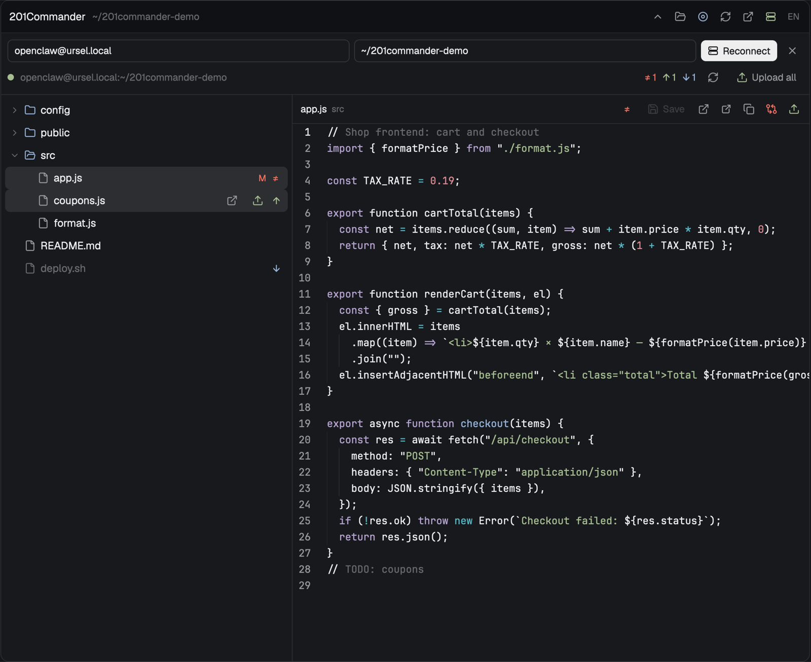

# 201Commander

A file browser for Herdr that opens on the active space's main folder. Edit files in place, jump to Finder, and mirror the folder onto an SSH server with the same structure: compare files, view a diff, upload or download with one click. The UI is in English and German.

**What you see:**
- It works as a pane (`pane.split {mod: "201commander"}`, ⌘⇧E with the bundled `keys.json`), as a side panel block, or as a window (`mod.open 201commander`; `mod.json` sets `overlay: {kind: "window", key: "201commander", width: 0.62, height: 0.82}`).
- Header (40px, `chrome` background): the title "201Commander", the root path (shortened with `~`) and icon buttons. From left to right: parent folder, pick a folder, main folder / pin (crosshair in `accent` while on the space's main folder, pin in `blocked` while pinned), reload, open in Finder, SSH (green when connected, red on error), an EN/DE language toggle, and × (only in a window).
- SSH bar, toggled by the SSH button: inputs for the host (`user@host[:port]`) and the remote path, a Connect button, a status dot, the counters `≠ n` (differs), `↑ n` (local only) and `↓ n` (server only), re-compare, and "Upload all".
- Tree (28px rows): chevron, folder/file icon, name, git mark (A/M/D/U) and compare badge (`≠` in `blocked`, `↑` in `ansi2`, `↓` in `ansi4`). Server-only entries are dimmed. The selected row shows its actions: Finder, terminal here, diff, get the server version, upload.
- At 760px or wider, the tree sits on the left (240–360px) with the editor or diff on the right, and long lines scroll. Narrower, one view shows at a time with a back arrow, and the editor soft-wraps.
- Editor: Herdr's `Editor` with syntax colors from the theme and a dirty dot. Toolbar: save, Finder, open with the default app, copy path, diff, upload.
- Diff: a unified diff, local (−) against server (+), in virtualized 20px rows, with upload and "take the server version".
- Footer: a confirm bar before any overwrite, a progress line with a spinner, or the last message.
- Retro mode (the monitor button, shared `201commander.retro`): a CGA palette (`#0000aa` background, `#55ffff` text, `#00aaaa` bar), the font `PxPlus IBM VGA 8x16` (shipped with Herdr 98) at 16px with no rounding. Layout: a cyan menu bar with "201Commander" in yellow on black, menu items Up / Dir / Pin / SSH / DE-EN / Modern, and a clock on the right. The panels are double-line frames (two nested 1px borders) with the title centered in the top line; the active one's title is black on cyan. Two panels side by side when wide: tree left, file or diff right. In the tree, folders are UPPERCASE white with "►SUB-DIR◄" (German "►ORDNER◄"), files are cyan, and the selection is a full-width cyan bar with black text. At the bottom sit a black command line `path>` with a blinking `_` (`.frames(["_", " "], 530)`) and the F1–F10 bar: a white number on black, then a black label on cyan.

**How it behaves:**
- Root: the git top level of the first terminal in the active space, else that terminal's folder, else `space.folder`. This is the folder Herdr names the space after. It changes with the space.
- Moving the root by hand (↑, double-click a folder, pick a folder) lasts until the space changes. The pin button goes back to the main folder.
- ⌘S saves through `writeTextFile` with the original text as `expected`. If the file changed on disk, a conflict bar offers Reload or Overwrite.
- SSH mappings live in shared state under `201commander.ssh` as `{localRoot: {host, remote}}`. Subfolders inherit the mapping, and recent hosts are kept in `201commander.hosts`. Opening a mapped folder reconnects automatically.
- Compare: one md5 listing per open folder, both local and remote (`md5sum`, else `md5 -q`). It runs on connect, when a folder is expanded, after a save, and after a transfer.
- Overwrites (an upload over `≠`, a download over a local file, bulk upload) ask first in the footer.
- Language: German when macOS's first language (`defaults read -g AppleLanguages`, else `$LANG`) is German, otherwise English. The EN/DE toggle stores an override in shared `201commander.lang`, and the mod commands `201commander.lang-de` / `lang-en` set it too. Every string goes through `L(de, en)`.

**Built from:** one mod, `201commander`: `main.js`, `mod.json` (`focusable`, window overlay) and Lucide-style `icons/*.svg`.
- `herdr` API: `exec` (running `sh`, `tar`, `diff`, `open`, `pbcopy`, `git` and `defaults`), `hc` (everything that talks SSH), `readTextFile`, `writeTextFile`, `watchFolder`, `pickFolder`, `shared`/`setShared`, `nextCommand` (`201commander.save`, `focus`) and `run("terminal.open")`.
- Everything that talks SSH runs through `hc(["exec", "--timeout", s, "--", ...])` in herdr-core, falling back to `exec`. On macOS the app itself can lack Local Network access (`host.local` fails with "No route to host"), and herdr-core has it.
- SSH runs with `BatchMode=yes` and a ControlMaster socket at `~/.ssh/herdr-201commander-%C` with `ControlPersist=300`.
- Uploads: files and folders both go as `COPYFILE_DISABLE=1 tar --no-xattrs -cf - ./name | ssh host 'mkdir -p parent && tar -C parent -xf -'`, without `.git` and `.DS_Store`. A file download goes through `mktemp "$f.201c.XXXXXX"` and then `mv -f`; a folder download goes `ssh tar -cf - | tar -xf -` (macOS bsdtar refuses `..`, absolute paths and writing through symlinks).
- Security: remote listings are untrusted. `safeName` drops names with `/`, `\0`, `.` or `..`, and `safeRel` guards every transfer and diff path. The SSH host from shared state is re-validated. `net()` probes `hc exec` once with `true` instead of retrying a failed command. "Upload all" names what it will send and skips `SENSITIVE` files (`.env*`, keys, certificates).
- Keyboard: the tree has its own focus handle (`treeHandle`, focused on row click and on the `focus` command) and a `ScrollHandle`. `rows()` also fills `this.flat`, the visible rows in order, which equals the tree's direct children, so `scroll_to_item(index)` follows the selection. `navKey`: ↑/↓, PageUp/PageDown (±15), Home/End, → (open, then the first child), ← (close, then the parent), Enter (open the file / toggle the folder; server-only rows do nothing), Backspace (parent root), Tab (focus the editor). Esc anywhere goes back to the list. Keys with cmd/ctrl/alt pass through.
- Quick search: in the tree, a typed character (`key_char`, no cmd/ctrl/alt; space only during a search) extends `query`. The search runs from the selected row on, wrapping: names starting with the query first, then names containing it. The same letter repeated jumps to the next match. Backspace shortens and Esc ends the search; 1 s without typing starts a new one (`QUERY_MS`, a `cx.timer.after` hides the box). The box sits bottom right of the tree (modern: a rounded pill with a search icon; retro: yellow on black "Search: …_"), red when nothing matches.
- New / rename / delete: a prompt bar in the footer (its own `InputState`, Enter submits, Esc cancels). New goes into the selected folder, or the selected file's folder; a name ending in `/` makes a folder. The new file opens in the editor. A rename selects the name without its extension and updates open folders, the open file and the diff to the new path; a case-only rename is allowed. The shell scripts exit 17 when the target exists. Delete asks in the confirm bar, then runs `/usr/bin/trash "$abs"` (macOS, with "Put Back"), else moves into `~/.Trash`, and the bar moves to the neighbouring row. The modern header has new file / new folder buttons; the selected row has rename / delete. Keys: F6, F7, F8, ⌘⌫ and Delete. All of it is off for spaces on another Herdr machine.
- F-keys: `fkey(n)` does Lang, Finder, Diff, Edit, Upload, Rename, New, Delete, SSH and Modern. Reload and Pin live in the retro menu bar. It is reached by clicks in the key bar and by `nextCommand` `"f1"`…`"f10"` (the `mod:201commander` section of `keys.json`, which wins over Herdr's global F2 = tab.rename).
- The optional `keys.json` binds ⌘⇧E to `pane.split` with the mod, and ⌘S inside the mod to `201commander.save`.

**Watch out:**
- SSH needs key or agent authentication. There is no password prompt (BatchMode).
- Remote paths are single-quoted for the remote shell, except a leading `~/`, which becomes `"$HOME"/'…'` so that `~/site` works.
- The class name can't start with a digit, so the module exports `class Commander` while the mod is named `201commander`.
- macOS `/usr/bin/trash` does not understand `--`: it trashes a file called `--` in the working directory. Pass only an absolute path.
- `EditorState.new` throws while rendering. Rebuild the editor (font or wrap change) in an event handler, or after `await cx.sleep(1)` in a spawned task. Create the new state before releasing the old one, or a failure leaves a released state on screen.
- `EditorState.soft_wrap` is fixed when the state is created. Crossing 760px rebuilds the editor, keeping the text and the selection.
- A view that holds the editor needs `h_full()` inside the body's `h_flex`, or it lays out at zero height.
- Text files only, up to 1 MiB (the `readTextFile` limit). Binary files open in the default app.
- Finder, Open and Copy path are macOS only (`open`, `pbcopy`).
- Spaces on another Herdr machine are read-only, and SSH is turned off there.
- Compare covers only the folders that are open, up to 1,000 entries each.

**Done when:**
- `herdr-app check mods/201commander` passes.
- The pane opens on the space's repository root.
- Clicking a file shows it with the full height, and typing then ⌘S writes it.
- Finder reveals the file.
- Connecting to a host with a mirrored folder shows the `≠/↑/↓` badges.
- The diff shows the change, and after an upload the file compares as equal.
